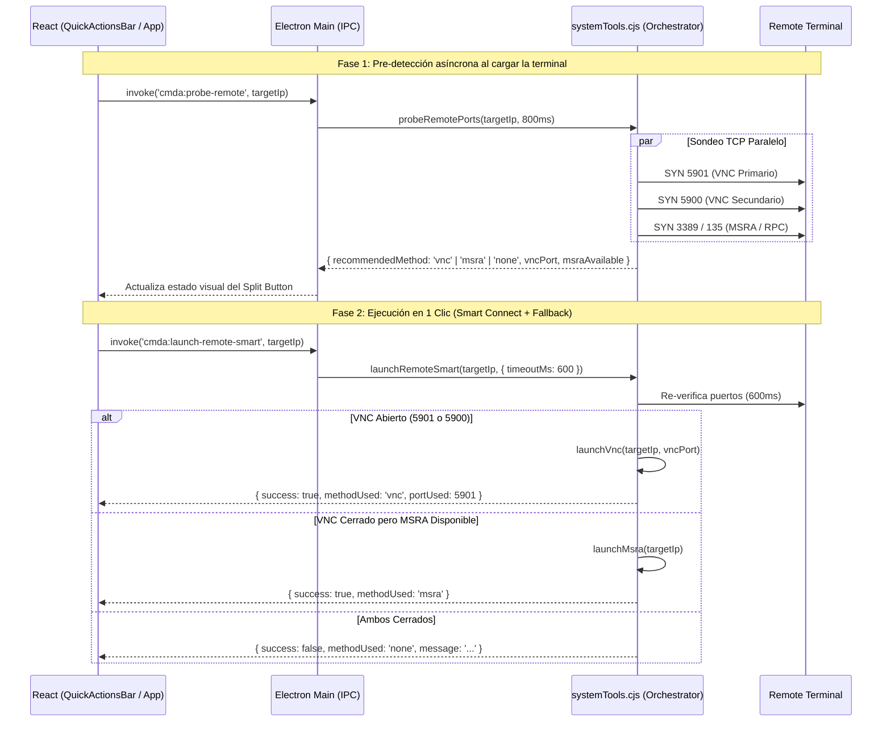

# Design Specification: Unified Smart Remote Connection Orchestrator (VNC & MSRA)

## 1. Overview & Purpose
Actualmente, **Portal Correo Desktop** presenta dos botones separados en `QuickActionsBar` ("VNC Viewer" y "Asistencia MSRA"). Esto obliga al operador de soporte a adivinar o probar manualmente qué método de conexión remota acepta la terminal consultada.

Este diseño introduce un **Orquestador de Conexión Remota Inteligente en el Backend (`electron/systemTools.cjs`)** acoplado a un **Split Button adaptativo** en la interfaz principal. El sistema realiza una pre-detección asíncrona al cargar la terminal para mostrar de inmediato qué método está disponible, y al hacer clic re-verifica rápidamente y lanza automáticamente el canal óptimo (`VNC :5901` $\to$ `VNC :5900` $\to$ `MSRA`), permitiendo además forzar manualmente cualquiera de los dos métodos mediante el menú desplegable lateral.

---

## 2. Architecture & Data Flow

---

## 3. Component & Module Specifications

### 3.1 Backend Orchestrator (`electron/systemTools.cjs`)
1. **`probeRemotePorts(host, timeoutMs = 800)`:**
   - Sondea en paralelo `5901`, `5900` y `3389` (más `135` RPC para mayor precisión en entornos Windows corporativos donde MSRA opera por DCOM/RPC).
   - Calcula y retorna `recommendedMethod`:
     - `'vnc'` si `5901` o `5900` están abiertos (`vncPort: 5901 | 5900`).
     - `'msra'` si VNC está cerrado pero `3389` o `135` están abiertos (`msraAvailable: true`).
     - `'none'` si todos los puertos están cerrados o dan timeout.
2. **`launchRemoteSmart(targetIpOrHost, options = {})`:**
   - Ejecuta `probeRemotePorts(cleanHost, options.timeoutMs || 600)`.
   - **Prioridad 1 (VNC):** Si `probe.vncPort` existe, invoca `launchVnc(cleanHost, probe.vncPort)` y retorna `{ success: true, methodUsed: 'vnc', portUsed: probe.vncPort, probe }`.
   - **Prioridad 2 (MSRA Auto-Fallback):** Si VNC está cerrado pero `probe.msraAvailable` es `true`, invoca automáticamente `launchMsra(cleanHost)` y retorna `{ success: true, methodUsed: 'msra', probe }`.
   - **Sin Conexión:** Si ninguno responde, retorna `{ success: false, methodUsed: 'none', vncClosed: true, msraAvailable: false, probe, message: '...' }`.

### 3.2 Contratos IPC (`electron/main.cjs`, `electron/preload.cjs`, `src/services/electronClient.ts`)
- **`cmda:probe-remote`:** Expuesto en `preload.cjs` como `probeRemote(target)` y en `electronClient.ts` como `probeRemoteStatus(target): Promise<RemoteProbeResult>`.
- **`cmda:launch-remote-smart`:** Expuesto en `preload.cjs` como `launchRemoteSmart(target)` y en `electronClient.ts` como `launchSmartRemoteClient(target): Promise<ToolExecutionResult>`.
- Se mantienen intactos `cmda:launch-vnc` y `cmda:launch-msra` para las acciones manuales forzadas desde el desplegable del Split Button y atajos de teclado.

### 3.3 Interfaz de Usuario (`src/components/QuickActionsBar.tsx` & `src/App.tsx`)
- **Reemplazo de 2 botones por 1 Split Button Inteligente:**
  - La grilla pasa de 4 columnas a **3 bloques principales** (`Conexión Remota Inteligente`, `Ping / -t`, `Uptime`), otorgando más aire visual y evitando truncamientos.
  - **Botón Principal (Izquierda del Split Button - Atajo `F2`):**
    - *Estado `'probing'`:* Icono `Loader2` girando + `"Detectando acceso..."`.
    - *Estado `'vnc'`:* Variante `default` (primaria), icono `MonitorPlay`, texto `"Conectar VNC (:5901)"` + badge `<Kbd>F2</Kbd>`.
    - *Estado `'msra'`:* Variante `secondary` con acento azul, icono `HelpCircle`, texto `"Conectar MSRA"` + badge `<Kbd>F2</Kbd>`.
    - *Estado `'none'`:* Variante `outline` neutra/alerta, icono `RefreshCw`, texto `"Sin Acceso (Reintentar)"` + badge `<Kbd>F2</Kbd>`. Al hacer clic, vuelve a ejecutar `launchSmartRemoteClient` para re-sondear al instante.
  - **Botón Desplegable Lateral (`▾` - Derecha del Split Button):**
    - Abre un menú flotante compacto con el diagnóstico en vivo de los puertos y 3 opciones manuales:
      1. **Forzar VNC Viewer (`F2` / Manual)** — muestra estado `[Abierto :5901 | Cerrado]`.
      2. **Forzar Asistencia MSRA (`F4`)** — muestra estado `[Disponible | Cerrado]`.
      3. **Re-escanear puertos de conexión** — refresca el estado del probe sin lanzar programas.

---

## 4. Error Handling & Edge Cases
- **Cambio de estado entre Pre-probe y Clic:** Si al cargar la terminal VNC estaba abierto, pero cuando el operador hace clic VNC se cerró y MSRA sigue activo, `launchRemoteSmart` hace el fallback automático a MSRA e informa con un toast claro: *"VNC no respondió; se inició Asistencia Remota (MSRA) automáticamente"*.
- **Protección contra múltiples clics:** Mientras `isConnectingRemote` está activo (~600ms), el botón muestra estado de carga para evitar abrir múltiples instancias de `vncviewer.exe` o `msra.exe`.
- **Zero-Secrets Compliance:** Todos los tests e IPs de prueba utilizan rangos de documentación RFC 5737 (`192.0.2.x`).

---

## 5. Testing Strategy
1. **Pruebas Unitarias de Backend (`src/services/systemTools.test.ts`):**
   - Verificar que `probeRemotePorts` identifica `'vnc'`, `'msra'` y `'none'` según los puertos abiertos.
   - Verificar que `launchRemoteSmart` prioriza VNC sobre MSRA cuando ambos están abiertos.
   - Verificar que `launchRemoteSmart` cae automáticamente en MSRA cuando VNC (5901/5900) está cerrado y MSRA está abierto.
2. **Pruebas de Componente UI (`src/test/QuickActionsBar.test.tsx`):**
   - Verificar renderizado del Split Button en cada estado (`probing`, `vnc`, `msra`, `none`).
   - Verificar que el desplegable lateral permite forzar VNC o MSRA manualmente.
3. **Auditoría Zero-Secrets (`src/test/securityAudit.test.ts`):**
   - Garantizar cero regresiones ni exposición de IPs privadas reales.
