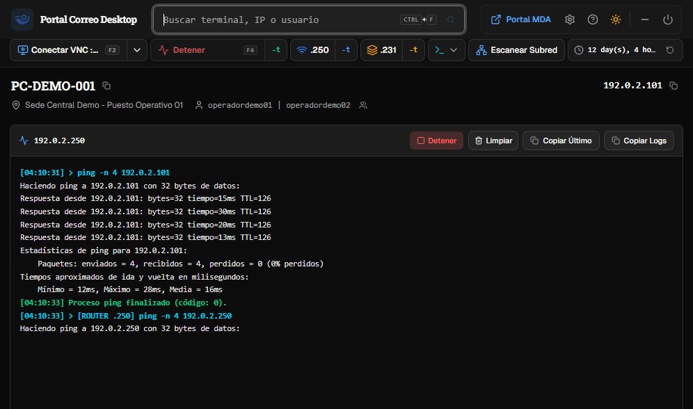
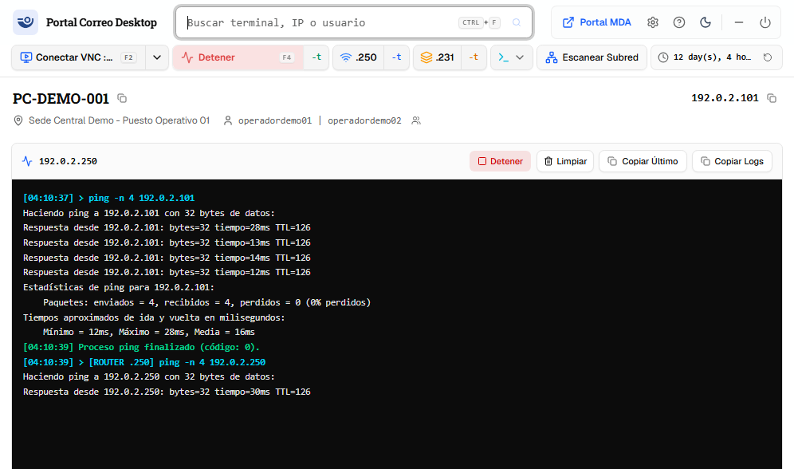
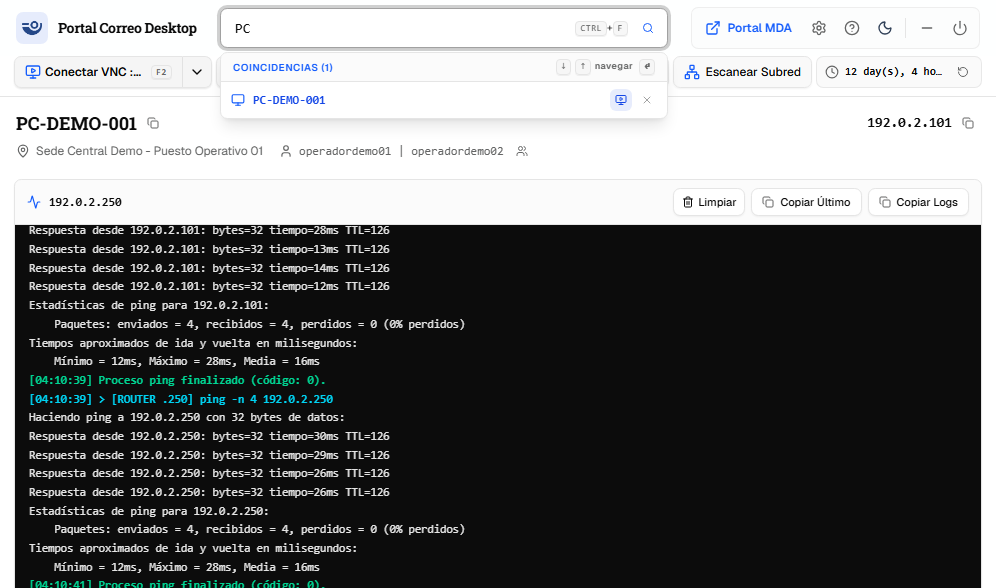

# Auditoría anti-UI-slop — Portal Correo Desktop

**Fecha:** 2026-11-02 (rev. 2026-11-03)
**Skills:** `anti-ui-slop` (playbook `reference/audit.md`) y `shadcn` (reglas oficiales de composición, §7.5)
**Alcance:** todo el front (`src/**`): 20 componentes propios, 12 primitivas shadcn, tokens de `src/index.css`, y el render real de la app construida a 1020×680.
**Modo:** auditoría. **No se modificó ningún archivo de producto** (solo se agregan este informe y sus capturas).

---

## 0. Veredicto

Esto **no** es slop de landing genérica: hay producto, hay flujo de trabajo real y la base shadcn está bien adoptada (tokens OKLCH, `data-slot`, `focus-visible`). El slop está en la **capa de acabado**, y es de un tipo específico: *dashboard técnico de agente de IA*.

Ocho arquetipos principales (el catálogo de §3 llega hasta S11):

| # | Arquetipo | Medida |
|---|---|---:|
| S1 | Color de paleta fijo en lugar de tokens semánticos | **106** usos / **5** tokens |
| S2 | Tipografía micro (9–11 px) y micro-etiquetas en mayúsculas | **69** tamaños a mano · **11** `uppercase` |
| S3 | Barra-vitrina: todo visible, todo con el mismo peso | **11** controles en 40 px |
| S4 | Consola "terminal" con altura fija (la superficie oscura es decisión de producto) | 384 px siempre |
| S5 | Feedback en cascada + feedback inline muerto | hasta 2 avisos por conexión |
| S6 | Tres implementaciones del mismo bloque de datos | 3 fichas, 2 layouts, 3 copiados |
| S7 | Primitivas rodeadas por markup propio | 4 `<input>`, 6 `<button>`, 3 menús a mano |
| S8 | Adornos de plantilla (icono en cuadrado teñido, `Sparkles`, sombras, estados vacíos genéricos) | 5 · 1 · 25 sombras · 4 |

### Restricciones fijadas por el producto (2/11/2026)

Estas decisiones mandan sobre cualquier recomendación del informe:

1. **La superficie de la terminal es oscura en ambos temas; su cromo respeta el tema de la app.** Es correcto —y esperado— que el header de la consola, sus botones y su borde sigan el tema elegido (`bg-card`, `border-border`, `text-foreground`) y que solo el *viewport de log* sea fijo oscuro. El juego `--console-*` aplica exclusivamente a esa superficie: no es un tema alternativo ni un bloque aislado de la app.
2. **Cero sombras nuevas y cero degradados; las sombras que traen las primitivas de shadcn se dejan intactas.** `shadow-*` prohibido en `src/components/*.tsx` (código propio), permitido en `src/components/ui/**` tal como llega del registry: ni se agregan ni se quitan. `bg-gradient-*` prohibido siempre, incluido el sheen del sidebar del sitio.
3. **Radios: solo los predefinidos del preset.** La escala derivada de `--radius` (`rounded-sm|md|lg|xl|2xl|3xl|4xl`); nunca `rounded-[…]` propio, nunca el `rounded` pelado (0.25 rem, fuera de escala) y nunca un override de radio sobre una primitiva. `rounded-full` solo para puntos de estado y avatares.
4. **Solo Radix.** Nada de `@base-ui/react`, y toda primitiva nueva entra por el registry `@shadcn` con base `radix`.

La causa raíz no es estética: **no existe un contrato de diseño ejecutable**. 92 de los 279 commits (33 %) son de UI y los mismos defectos sobreviven a la auditoría del 27/10 (`docs/ui-ux-audit-2026-10-27.md`): el typo `bg:text-inherit`, los tres componentes muertos, el toast duplicado y la micro-tipografía siguen exactamente igual.

A eso se suma una deuda de sistema de componentes (§7): **2 primitivas instaladas no se usan** (`Card`, `Alert`), **13 nativas faltan** donde hoy hay markup propio —4 ni figuraban en la primera pasada (`Empty`, `Skeleton`, `Field`/`FieldGroup`, `InputGroup`) y `ToggleGroup` reemplaza a `RadioGroup`— y la base Radix sobre la que está construido todo **no está declarada en ningún lado**: hoy se resuelve por fallback del CLI, que en su flujo de init recomienda Base UI.

Y el tema **no es el del sitio principal** (§8): `src/index.css` es un fork del preset `b5XRZYXrNg`, con **11 valores cambiados, 20 tokens ausentes y 1 inventado** (`--info`), mientras `components.json` declara `"style": "default"` y el test se sigue llamando `b5XRZYXrNg`. Tres definiciones distintas de "qué estilo somos".

---

## 1. Método y límites

1. Lectura estática de los 20 componentes propios + 12 primitivas + tokens.
2. Conteo por patrón sobre `src/**` (script de una pasada, ver §9).
3. **Render real**: build de `dist` servido con `vite preview` y capturado con Edge headless por CDP a 1020×680, en tema oscuro y claro, con una terminal cargada, el modal de ajustes abierto y el desplegable de búsqueda en uso. Las capturas están en `ui-slop-audit-2026-11-02/`.
4. `npm run audit:contrast` ejecutado sobre los tokens actuales: **0 fallas de texto**, **3 fallas de borde** (1.26–1.32:1 contra el mínimo 3:1).
5. Verificación en el CSS compilado (`dist/assets/index-*.css`) de las clases dudosas: `bg:text-inherit` genera solo `.text-inherit`, `py-0.2` **no genera nada**.
6. Verificación del stack de primitivas y del comportamiento del CLI de shadcn leyendo el paquete instalado (`node_modules/shadcn@4.22.1`, `node_modules/@shadcn/registry`) y el contenido real del asar de release. No se ejecutó `shadcn add`.
7. Comparación token a token del CSS del sitio principal (`radix-vega`, preset `b5XRZYXrNg`) contra `src/index.css`, con el contraste de los valores canónicos recalculado (§8).
8. Contraste regla por regla contra la skill oficial `shadcn` instalada en el repo (`.agents/skills/shadcn`), con conteo de cada patrón que la skill prohíbe (§7.5, S11).

**No cubierto:** comportamiento con lector de pantalla, rendimiento en runtime, shell de Electron (titlebar propio), y contraste de los colores hardcodeados sobre tinte (se citan los del informe anterior, no se re-midieron).

---

## 2. Los tres hallazgos materiales

### F1 · La pantalla principal es una barra de 11 controles más una consola de 384 px; lo que el operador necesita queda debajo del pliegue

**Observable:** en la ventana real (1020×680, área de contenido de la captura 996×588) el primer scroll muestra: topbar → barra de acciones → identidad → **consola de 384 px** → y recién ahí "Datos del equipo" y "Alertas y reseteos".



- La barra tiene **11 controles interactivos** en una sola fila (`QuickActionsBar.tsx:157-519`): split VNC, split ping, split `.250`, split `.231`, Diag, Escanear Subred, refrescar uptime. Cuatro de ellos son *split buttons* con `shadow-xs`.
- La consola mide `clamp(24rem, 55vh, 48rem)` con `min-h-[24rem]` (`LivePingConsole.tsx:328-330`). Con 680 px de alto útil, `55vh` = 374 px, por debajo del piso: el `clamp` **siempre devuelve 384 px**, ~56 % de la ventana.
- **Dos botones "Detener"** para el mismo ping, uno en la barra (`QuickActionsBar.tsx:292-313`, rojo y con `animate-pulse` sobre todo el botón) y otro en la cabecera de la consola (`LivePingConsole.tsx:241-253`).
- El texto se pierde por truncado, no por falta de espacio: `Conectar VNC :…` y `12 day(s), 4 ho…` (`max-w-[100px]`, `QuickActionsBar.tsx:499`). Además "day(s)" es inglés filtrado a una UI en español.

**Corrección mínima:** dejar dos acciones visibles (Conectar / Ping) y mover el resto a un único menú "Más"; colapsar la consola a una fila de 32 px con el resumen del último diagnóstico y expandirla solo por acción explícita. Recupera ~350 px y saca Alertas al primer scroll.

---

### F2 · El color de estado es decoración, no sistema: 106 colores de paleta fijos contra 5 usos de tokens semánticos

**Observable:** los tokens `--success`, `--warning` y `--info` existen (`index.css:73-75`) y se usan **5 veces en todo el repo**. En paralelo hay **106** clases de paleta Tailwind fijas:

| Paleta | Usos |
|---|---:|
| `emerald-*` | 39 |
| `blue-*` | 35 |
| `amber-*` | 23 |
| `cyan-*` | 5 |
| `slate-*` / `zinc-*` | 3 |
| `red-*` | 1 |

Cada control de la barra eligió un color distinto sin que el color signifique nada: VNC azul, ping verde, `.250` azul, `.231` ámbar, Diag cian, Subred azul (`QuickActionsBar.tsx:341-402`). Los mismos hues reaparecen en el menú contextual (`OperatorContextMenu.tsx:100,117,135,198`) y en el drawer (`SubnetScannerDrawer.tsx:192-214`).



La consola oscura en tema claro **no es parte del hallazgo**: es una decisión de producto (restricción 1). Lo único que se le pide es dejar de estar hardcodeada: `bg-[#0C0C0C]` y `text-[#CCCCCC]` (`LivePingConsole.tsx:330`) pasan a un juego `--console-*` que no cambia con el tema, y listo. El resaltado por subcadena en inglés (`line.includes("Error")`, `includes("cerrado")`, `LivePingConsole.tsx:350-364`) sobre salida en español sí sigue siendo defecto (§S4).

**Corrección mínima:** un color por significado (`primary` = acción remota, `success` = alcanzable, `warning` = alcanzable con problemas, `destructive` = detenido) y cero `blue/emerald/amber/cyan` en componentes. La consola se queda oscura en ambos temas y se tokeniza como superficie fija.

---

### F3 · Tres implementaciones del mismo bloque de datos, dos del mismo layout, y tests que sostienen las muertas

**Observable:**

| Componente | Estado | Qué muestra |
|---|---|---|
| `TerminalDetailsGrid.tsx` | **en uso** (`App.tsx:767`) | MAC, SO, build, CPU, RAM, arquitectura, relevamiento, AV, navegador, centro de costo |
| `HardwareCard.tsx` | **muerto** | SO, CPU, RAM, AV, navegador, relevamiento |
| `NetworkAdCard.tsx` | **muerto** | IP, MAC, UserNT, sede, centro de costo + badge "En Línea" **fijo** |
| `Sidebar.tsx` | **muerto** | navegación por tabs (*inventario / alertas / reseteos*) que el producto ya no tiene |

Ninguno de los tres muertos se importa en la app (`App.tsx` no los referencia), pero `ShadcnPreset.test.tsx:108-137`, `CardsContrastCopy.test.tsx` y `TerminalCards.test.tsx` los renderizan: **los tests son la razón por la que siguen vivos**. `App.test.tsx:179` incluso afirma que el Sidebar *no* debe existir.

Peor: `NetworkAdCard.tsx:27-32` muestra un badge "En Línea" hardcodeado. Está muerto hoy; si alguien lo reusa, miente sobre el estado.

También hay **tres implementaciones de copiar al portapapeles** (`HardwareCard.tsx:30-36`, `NetworkAdCard.tsx:11-17`, `OperatorContextMenu.tsx:64-69`) conviviendo con `CopyValueButton` + `useCopyToClipboard`, que son la que está bien.

**Corrección mínima:** borrar los tres archivos, repuntar los tests a `TerminalDetailsGrid` y agregar un test de contrato que falle si reaparece un `bg-emerald-`/`text-[9px]`/`<input` fuera de `ui/`. Sin ese test, el patrón vuelve: ya volvió una vez.

---

## 3. Catálogo completo

### S1 · Paleta fija en lugar de tokens — *sistémico*
106 usos (95 en componentes propios, 8 en la primitiva `Alert` y 3 en `Sonner`), 5 usos de tokens semánticos. Los pares claro/oscuro se escriben a mano en cada sitio (`text-blue-600 dark:text-blue-400`), así que cualquier cambio de marca requiere 106 ediciones.

### S2 · Tipografía micro y micro-etiquetas — *sistémico*
- **69** tamaños arbitrarios: **7** de 9 px, **20** de 10 px, **41** de 11 px, **1** de 11.5 px.
- **11** `uppercase` + **11** `tracking-wider`, casi siempre combinados: `DATOS DEL EQUIPO` (`TerminalDetailsGrid.tsx:50`), `COINCIDENCIAS (1)` (`Topbar.tsx:289`), `ACTUALIZACIONES DEL SISTEMA` (`SettingsModal.tsx:181`), `CAPACIDADES PRINCIPALES` (`InfoModal.tsx:92`), `Navegación` (`Sidebar.tsx:46`).
- El primitivo `Kbd` es de **9 px en mayúsculas con `tracking-wider`** (`ui/kbd.tsx:11`): la ayuda de teclado es lo menos legible de la app. Y su `py-0.2` no compila (verificado en el CSS construido).
- **Dos sistemas de título compitiendo**: Roboto Slab en versalitas normales (`font-heading`: "Alertas y reseteos", "PC-DEMO-001") contra Geist en mayúsculas de 10-11 px. Se ven uno al lado del otro en la misma pantalla.

### S3 · Barra-vitrina — *componente*
`QuickActionsBar` es un índice de todo lo que la app sabe hacer, sin jerarquía: 11 controles, 4 *split buttons*, 3 atajos (`F2`/`F4`) dibujados como `Kbd` dentro de los botones, y un flag de línea de comandos (`-t`) como etiqueta en la UI de primer nivel. Todos con `variant="outline"` + `bg-muted`: el mismo peso visual para "conectar a la máquina del usuario" y "hacer ping al router".

### S4 · Consola: superficie oscura intencional; tamaño y resaltado no — *componente*
La superficie de log se queda oscura en ambos temas (decisión de producto): **eso no se toca**. El *chrome* —barra de título, botones y borde— **sigue el tema de la app, y está bien que lo haga** (restricción 1): no es un bloque oscuro, es una consola con viewport oscuro. Lo que sí es deuda: (a) los colores del viewport están hardcodeados (`#0C0C0C`, `#CCCCCC`, `#E5E5E5`) en lugar de ser un juego `--console-*` explícito; (b) 384 px fijos aun sin salida y 4 botones de igual peso en la cabecera (Detener / Limpiar / Copiar Último / Copiar Logs); (c) el coloreado por coincidencia de palabras en inglés sobre salida en español.

### S5 · Feedback en cascada — *flujo*
Las acciones de conexión disparan `toast.info("Acción disparada: {label} para {pc}")` (`QuickActionsBar.tsx:108-111`) —copy de desarrollador— **más** el toast de resultado de `App` **más** el cambio de estado del botón; las de diagnóstico, en cambio, no avisan nada fuera de la consola. Mientras tanto `actionFeedback` —el prop pensado para mostrar el resultado inline— **se desestructura y nunca se renderiza** (`QuickActionsBar.tsx:71`; cero usos en el cuerpo). El operador que mira la ficha no ve ninguno de los avisos de esquina.

### S6 · Duplicados y código muerto — *arquitectura*
Ver F3. Añadido: `rounded-lg` a mano sobre `Card` que ya es `rounded-xl` (`HardwareCard.tsx:39`, `NetworkAdCard.tsx:20`), y `rounded`/`rounded-md`/`rounded-lg`/`rounded-xl`/`rounded-4xl` conviviendo en badges del mismo tipo de dato.

### S7 · Primitivas rodeadas — *componente*
- **Buscador**: listbox propio (`Topbar.tsx:284-385`) sin `role="listbox"`/`aria-selected`. La fila seleccionada por teclado **no tiene fondo en tema claro**: la clase `bg:text-inherit` (`Topbar.tsx:312`) es inválida — el CSS construido solo emite `.text-inherit`, y el fondo solo existe en `dark:bg-muted/80`. Verificado en el render: la fila activa es indistinguible.

  

- **Drawer de subred**: `fixed inset-0 z-50` sin `role="dialog"`, sin `aria-modal`, sin foco atrapado y sin cerrar con Escape (`SubnetScannerDrawer.tsx:147-157`). El filtro es un `<input>` a mano con `focus:ring-1` (`:219-225`) porque la primitiva `Input` no se usó.
- **Menú contextual**: menú propio de 242 líneas sin `role="menu"` ni navegación por teclado (`OperatorContextMenu.tsx`), con `backdrop-blur` y `shadow-xl`.
- **44 `title=`** nativos en lugar de `Tooltip` (sin foco, sin teclado, ~1 s de demora, sin estilo).
- **Checkboxes** del modal de ajustes son `<input type="checkbox">` con `text-primary` (`SettingsModal.tsx:391-407,414-431`), que sin `accent-color` no tiñe nada; el radio de `NetUserChooserDialog.tsx:73` sí usa `accent-primary`. Dos estilos de control para la misma decisión.

### S8 · Adornos de plantilla — *estética*
- **Icono en cuadrado redondeado teñido**, cinco veces: `Topbar.tsx:230`, `Topbar.tsx:363`, `InfoModal.tsx:63`, `SettingsModal.tsx:163`, `SubnetScannerDrawer.tsx:162`.
- `Sparkles` + "¡Nueva versión disponible!" (`SettingsModal.tsx:228-241`): voz de SaaS en una herramienta interna de soporte.
- `InfoModal` es una lista de "capacidades" con atajos, material de folleto dentro de la app.
- **Estados vacíos genéricos** repetidos casi literalmente: `App.tsx:696-741` (dos bloques con borde punteado, círculo con icono, título y párrafo, a altura completa). El de "no encontrada" ofrece una sola salida: "Limpiar búsqueda".
- Carga = un `Loader2` girando en 320 px vacíos (`App.tsx:672-678`), sin skeleton.
- **Elevación: 25 `shadow-*`**, de los cuales **7 son de primitivas** (`button`, `card`, `dialog`, `input`, `kbd`, `sonner`, `textarea`) y **se quedan tal como llegaron**. Los 18 de código propio salen: la jerarquía se hace con borde, fondo y espaciado. **Degradados: 0 en la app**; el único del sistema es el sheen del sidebar del sitio, que no se adopta (§8.5).
- **Radios mezclados**: `rounded` (0.25 rem, fuera de la escala), `rounded-md`, `rounded-lg`, `rounded-xl`, `rounded-4xl` y `rounded-[min(…)]` conviviendo en el mismo tipo de dato (badges de estado, botones de 24 px). La restricción 3 los lleva a la escala del preset y a un radio por tipo de componente; `rounded-full` queda solo para puntos de estado y el círculo de `BlockedScreen`.
- `backdrop-blur` en 5 lugares (Topbar, menú contextual, drawer, diálogo): con minimalismo, el overlay se distingue por borde y opacidad de fondo, no por desenfoque.

### S9 · Breakpoints que no cubren la ventana real — *layout*
La ventana es 1020×680 y **tres decisiones dependen de anchos que nunca ocurren**:

| Clase | Breakpoint | Efecto a 1020 px |
|---|---|---|
| `hidden lg:flex` (badge de conexión, `Topbar.tsx:392`) | 1024 | El estado de conexión **desaparece** |
| `lg:grid-cols-3` (grilla de datos, `TerminalDetailsGrid.tsx:55`) | 1024 | Queda en 2 columnas (visible en el render) |
| `xl:inline` (etiqueta "Diag", `QuickActionsBar.tsx:403`) | 1280 | Botón solo-icono, sin texto |

Es diseño escrito para una pantalla que el producto no puede tener: decoración responsiva en vez de la restricción real.

### S10 · Menores (no materiales, pero de la misma familia)
- `--font-mono` declara `"Geist Mono"` (`index.css:13`) y **no está instalado** (`package.json` solo trae Geist y Roboto Slab): el mono real es `Cascadia Mono`. La sans y la mono vienen de dos familias distintas de fuentes.
- Tema por defecto **oscuro** y sin `prefers-color-scheme` (`ThemeContext.tsx:13-16`).
- `--chart-1..5` y los 8 tokens `--sidebar-*` (`index.css:36-43,80-92`) no se usan en ningún componente vivo: el tema se copió completo.
- Las primitivas importan `cn` desde el paquete `"cn"` y el resto del código desde `@/lib/utils`: el próximo `shadcn add` va a mezclar convenciones otra vez.

### S11 · Markup que contradice las reglas de composición de shadcn — *sistémico*
Medido contra la skill oficial (§7.5), no contra gusto:
- **59 `space-y-*` + 2 `space-x-*`** en lugar de `flex` + `gap-*` (`SettingsModal` 15, `ActivityDialogs` 8, `App` 6).
- **46 `dark:`** manuales: pares claro/oscuro escritos a mano, que la skill prohíbe porque ya existen los tokens.
- **138** pares `h-N w-N` candidatos a `size-*`; muchos son íconos dentro de `Button`, que además deberían ir sin clase de tamaño y con `data-icon` (**0 usos** hoy).
- **23** `` className={` `` con ternarios en vez de `cn()`.
- **7** `z-50` manuales, 5 en overlays propios (`Topbar`, `QuickActionsBar` ×2, `OperatorContextMenu`, `SubnetScannerDrawer`).
- Sin `Separator` (se usa `border-b`), sin `Skeleton` (`Loader2`), sin `Empty`, sin `Field`/`FieldGroup` (divs), sin `InputGroup` (input con botones posicionados a mano).

---

## 4. Lo que ya está bien (no tocar)

- Tokens OKLCH completos y tema oscuro/claro real; los pares de texto pasan AA (script del repo).
- shadcn adoptado de verdad en los diálogos y formularios: `data-slot`, `focus-visible:ring-3`, `aria-invalid`, `sr-only` en los controles de icono.
- `aria-label` + `aria-pressed` + `aria-expanded` + `title` están, sin excepción, en los botones de icono que revisé.
- Existen los estados de carga, vacío, "no encontrado", error (`ErrorBoundary`) y bloqueo por seguridad (`BlockedScreen`) con recuperación.
- La identidad de la terminal está resuelta con jerarquía real (hostname grande, IP mono a la derecha, sede/usuario debajo) y `truncate` + `title` en los valores largos.
- Las tablas de actividad usan la primitiva `Table`, con `StatusBadge` por tokens y expansión con `aria-expanded`/`aria-controls`.

---

## 5. Plan por fases — dependencias primero

El orden no es por impacto visual, es por **dependencia**: casi todo lo demás necesita que el CLI resuelva, que `radix-ui` esté instalado y que los componentes existan. Por eso la Fase 0 se hace completa antes de tocar un solo archivo de UI.

### Fase 0 · Dependencias e instalables (≈ 1,5 h)

| # | Acción | Por qué primero | Esf. |
|---|---|---|---|
| 0.1 | `npx shadcn@latest preset decode b5XRZYXrNg` y `preset resolve --json` | La skill prohíbe decodificar presets a mano: esto da los valores canónicos y qué detecta el CLI | 5 min |
| 0.2 | `components.json` → `"style": "radix-vega"` (o `apply b5XRZYXrNg --only theme,font` una vez fijado el style) | Sin style con prefijo, **todo `add` da 404** y la base queda implícita (§7.3) | 10 min |
| 0.3 | `npx shadcn@latest migrate radix` | Agrega el paquete unificado `radix-ui` y unifica imports; los ítems del registry lo dan por instalado | 20 min |
| 0.4 | `npm i @fontsource-variable/geist-mono` | Es el mono del sitio; hoy cae en Cascadia | 5 min |
| 0.5 | `npm i -D shadcn`, quitar `next-themes`, rebuild | −38,9 MB y −5.884 archivos (medido) (§7.4) | 10 min |
| 0.6 | `add command popover context-menu sheet tooltip switch toggle-group progress collapsible alert-dialog` | Habilita las fases 2 y 3; ninguna otra decisión depende de esto | 10 min |
| 0.7 | `add empty skeleton field input-group` (con `npx shadcn view` previo de cada uno) | Son las que faltaban en la primera pasada (§7.5) | 10 min |
| 0.8 | Leer cada archivo instalado y verificar composición, imports e `iconLibrary` | Workflow de la skill, paso 7: el registry no garantiza que el archivo llegue correcto | 20 min |

**Criterio de salida:** `npm run build` verde · `package.json` con `radix-ui` y **sin** `@base-ui*` ni `next-themes` · `src/components/ui/` con los **15** archivos nuevos (12 en Task 5 + 3 en Task 6; `toggle` e `input-group` llegaron como registryDependencies) · `shadcn add` deja de devolver 404 · cada archivo nuevo leído y anotado.

### Fase 1 · Tema, tokens y contrato (≈ 7 h)

> **Estado (2026-11-03):** ejecutada en `feat/fase-1-tema` (T0-T8 + T10; T9 `eject` queda para Fase 3). Tokens del preset heredados (0 desvíos, 20 tokens nuevos) · `--console-*` fijas y consumidas · `theme-transition` cableado · scrollbars webkit-only en `@layer base` · overlays y textos alineados · `TooltipProvider` montado · guard 10/10 · ratchet con baseline 95/18/9/5 · fuentes en devDependencies. Suite 341/341, build verde, contraste con 5 excepciones documentadas.

| # | Acción | Cierra |
|---|---|---|
| 1.1 | Reemplazar `@theme inline` + `:root` + `.dark` por los del sitio (§8.2), conservando `.app-drag-region` y `h1..h4` | S1, §8.3 |
| 1.2 | Sumar `@layer base` / `@layer components` y los scrollbars; **no** el sheen del sidebar (degradado, restricción 2) | §8.5 |
| 1.3 | Juego `--console-*` fijo solo para el viewport del log; header y controles siguen el tema | S4 |
| 1.4 | Documentar las 2 excepciones de contraste (`--muted-foreground` 0.505, `--destructive` 0.52) | §8.4 |
| 1.5 | Test de contrato: sin `shadow-*` en `src/components/*.tsx`, sin `bg-gradient-*`, sin paleta fija, sin `rounded-[`, sin `<input` fuera de `ui/` | S1-S4, S7 |

**Criterio de salida:** `npm run audit:contrast` verde con las excepciones anotadas · el test de contrato corre en `npm test` y falla si alguien reintroduce una sombra propia, un degradado o un `rounded-[…]`.

### Fase 2 · Superficies y densidad (≈ 9 h)

> **Estado (2026-11-03):** ejecutada en `feat/fase-2-superficies` (T0-T9). `Card` en las 6 superficies · `Alert` inline y muerte del toast "Acción disparada" · consola colapsable con `Collapsible` (arranca cerrada y abre al ejecutar un comando) · barra con 2 acciones primarias + menú "Más" (`Popover`) · `Input` en el filtro del drawer · `Empty`/`Skeleton` en `App.tsx` · `Field` con label, descripción y `aria-invalid` en los cuatro diálogos. Paleta fija 95 → **0** clases (94 al abrir T6), sombras propias 15 → **0**, radios pelados 9 → **0**; ratchet en **0/0/0/4**. `--strict` en 0 con `EXCEPTIONS` vacío: las cinco excepciones se resolvieron con token (`--muted-foreground` 0.545, `--destructive` 0.49, `--success` 0.49, `--warning` 0.52, `--info` 0.50) y reescribiendo los pares que ya no describían la app. La consola estrena tokens fijos `--console-success/warning/info/destructive`, sin variante `.dark`, porque los semánticos del tema quedaban en 3,5-4,1:1 sobre el viewport oscuro. Suite 361/361, build verde, ambos comandos de contraste en exit 0.
>
> **Desvíos registrados:** (a) `--info` no se elimina: se conserva como semántica de diagnóstico y ahora tiene consumidores reales, así que el punto 6.1 se cumple igual; (b) `text-primary` deja de usarse como texto en favor de `--link`; (c) las sombras y radios de `src/components/ui/**` quedan exactamente como llegaron del registry, también en `alert`/`sonner`, donde sólo se mapearon colores.

| # | Acción | Cierra |
|---|---|---|
| 2.1 | `Card` en las 6 superficies hechas a mano | S6 |
| 2.2 | Consola colapsable a 32 px con `Collapsible` | **F1** |
| 2.3 | Barra de 2 acciones visibles + menú "Más"; se elimina el truncado de `Conectar VNC :…` | S3 |
| 2.4 | `Alert` inline para el resultado de la acción (muere el toast "Acción disparada") | S5 |
| 2.5 | `Input` en el filtro del drawer | S7 |

### Fase 3 · Interacción accesible (≈ 2 d)

`Sheet` (drawer), `ContextMenu` (menú propio), `Tooltip` (los 44 `title=`), `Command` + `Popover` (buscador), `ToggleGroup` (modo de ping), `Progress` (las 2 barras), `AlertDialog` (cierre de alerta). Todo con `data-slot`; las sombras que traigan las primitivas quedan como vienen.

### Fase 4 · Limpieza (≈ 2 h)

Borrar `HardwareCard`, `NetworkAdCard` y `Sidebar`; repuntar los 3 tests que los sostienen; borrar el import de `Card` que queda muerto.

### Fase 5 · Tipografía y adornos (≈ 6 h)

Escala 18/14/12/11, overlines, iconos en cuadrado teñido, estados vacíos con acción, skeletons.

> **Total:** ≈ 4,5 días de trabajo, con la regla de que ninguna fase arranca si la anterior no dejó el build verde.

---

## 6. Para que no vuelva

El motivo por el que estos patrones persisten no es falta de criterio: es que **nada los detecta**. Nueve reglas medibles, cada una con su test, cortan la recurrencia:

1. **Un color por significado, y el significado viene del sitio.** Prohibido `blue|emerald|amber|cyan|red|slate|zinc` en `src/components/*.tsx`; solo `primary|success|warning|destructive|muted` y, donde haga falta semántica propia, `category-*` / `office-type-*`. Ningún componente inventa un hex ni un token (`--info` se elimina).
2. **Piso tipográfico 11 px** y máximo 5 overlines en mayúsculas en toda la app.
3. **Un breakpoint objetivo: 1020 px.** Si algo necesita `lg:` o `xl:`, no existe en este producto.
4. **Toda interacción nueva usa una primitiva** (`Command`, `Sheet`, `ContextMenu`, `Tooltip`, `Collapsible`). El markup propio solo compone.
5. **Cero código muerto sostenido por tests**: un componente sin import en `App.tsx` no tiene test propio.
6. **La base la decide el repo, no el CLI**: nunca `shadcn init` sobre este repo (su default es `base-nova`, Base UI), y `components.json` nunca queda sin un `style` con prefijo (`radix-…`). Un `@base-ui-components/react` en `package.json` es una regresión.
7. **Sin sombras nuevas ni degradados; las del registry se respetan.** `shadow-*` prohibido en `src/components/*.tsx`; en `src/components/ui/**` se deja exactamente lo que llegó del registry, sin agregar ni quitar. `bg-gradient-*` prohibido siempre. La jerarquía propia se hace con borde, fondo y espaciado. Los `ring-*` de foco no son sombras y se conservan.
8. **Radios del preset.** Solo la escala derivada de `--radius` (`sm|md|lg|xl|2xl|3xl|4xl`); prohibido `rounded-[…]`, el `rounded` pelado (fuera de escala) y cualquier override de radio sobre una primitiva. `rounded-full` solo para puntos de estado, avatares y el círculo del `BlockedScreen`. Un mismo tipo de componente usa siempre el mismo radio (hoy un badge es pill y otro es rectángulo).
9. **La consola tiene viewport oscuro y cromo temático.** `--console-bg` / `--console-fg` / `--console-muted` fijos para el log, sin variante `.dark`; el header y los controles usan los tokens normales del tema. Si en el futuro se quiere el bloque entero oscuro, es una decisión nueva, no una consecuencia de esta regla.

---

## 7. Cobertura shadcn + Radix — qué falta, qué sobra y cómo no desviarse a Base UI

### 7.1 Qué hay hoy (verificado en el repo, no en la documentación)

> **Estado tras Fase 0 (2026-11-03):** esta tabla es la foto del 2/11. Al 2026-11-03: `radix-ui` unificado instalado, cero paquetes `@radix-ui/*` en `package.json`, `shadcn` en devDependencies y `Card`/`Alert` siguen sin uso en la app (eso no cambió).

| Comprobación | Resultado |
|---|---|
| Primitivas Radix instaladas | **4**: `@radix-ui/react-dialog`, `react-label`, `react-separator`, `react-slot` (+ transitivas) |
| Base UI | **0**: no está `@base-ui-components/react` ni el `radix-ui` unificado; `package-lock.json` no la menciona en ninguna línea; `node_modules/@base-ui` existe pero es una **carpeta vacía**, sin `package.json` ni entrada en el lockfile |
| Componentes shadcn | 12, copiados al repo en `src/components/ui/` (no son un paquete instalado) |
| Instaladas **sin uso en la app** | **2**: `Card` (solo la importan `HardwareCard` y `NetworkAdCard`, ambos muertos) y `Alert` (solo `ShadcnPreset.test.tsx`) |
| Instalada y esquivada | `Input`: se usa en 3 lugares y se reemplaza a mano en `SubnetScannerDrawer.tsx:219-225` |
| Primitiva visual reimplementada | El "card" (`rounded-lg border border-border bg-card`) aparece **6 veces**: `TerminalDetailsGrid.tsx:46`, `LivePingConsole.tsx:226`, `ActivityPanel.tsx:188`, `InfoModal.tsx:95`, `OperatorContextMenu.tsx:79`, `SubnetScannerDrawer.tsx:269` |
| Dependencia muerta | `next-themes` no se importa en ningún archivo: `ui/sonner.tsx:8` ya usa el `ThemeContext` propio |

### 7.2 Reemplazos propuestos

| # | Hoy (hecho a mano) | shadcn | Primitiva real | Qué cierra | Esf. |
|---|---|---|---|---|---|
| 1 | 6 superficies de card | `Card` **(ya instalada)** | HTML | S6: radios y padding distintos en cada bloque | 2 h |
| 2 | Errores y avisos solo por `toast` | `Alert` **(ya instalada)** | HTML | S5: feedback inline que hoy no existe | 1 h |
| 3 | Filtro del drawer (`:219-225`) | `Input` **(ya instalada)** | HTML | S7: dos inputs con estilos distintos | 15 min |
| 4 | Listbox del buscador (`Topbar.tsx:284-385`) | `Combobox` | **Base UI** → descartado | — (no usar: ver nota) | — |
| 4b | Ídem, sin Base UI | `Command` en `Popover` | **cmdk** + Radix Popover | S7: `aria-selected`, fila activa visible, navegación | 1 d |
| 5 | Menú contextual propio (242 líneas) | `ContextMenu` | Radix ContextMenu | S7: `role="menu"`, flechas, foco, submenú | 4 h |
| 6 | Drawer de subred (`:147-157`) | `Sheet` | Radix Dialog | S7: `aria-modal`, focus trap, cierre con Escape | 3 h |
| 7 | 44 `title=` nativos | `Tooltip` | Radix Tooltip | S7: ayuda de teclado, demora configurable, estilo del sistema | 4 h |
| 8 | Checkboxes (`SettingsModal.tsx:391-407,414-431`) | `Switch` o `Checkbox` | Radix Switch / Checkbox | S7: hoy no se tiñen (`text-primary` sin `accent-color`) | 1 h |
| 9 | "Modo de ping": 2 botones que simulan un segmented control (`:440-463`) | `ToggleGroup` | Radix ToggleGroup | S3: la skill pide `ToggleGroup` para 2–7 opciones, no botones con estado manual | 1 h |
| 10 | 2 barras de progreso con `style={{width}}` (`SettingsModal.tsx:277-282`, `SubnetScannerDrawer.tsx:207-214`) | `Progress` | Radix Progress | S1 (hues fijos) + `aria-valuenow` | 1 h |
| 11 | Consola fija de 384 px (`LivePingConsole.tsx:328-330`) | `Collapsible` | Radix Collapsible | **F1**: la consola colapsable a 32 px | 3 h |
| 12 | Cierre de alerta con `Dialog` (`ActivityDialogs.tsx:244-291`) | `AlertDialog` | Radix AlertDialog | Acción destructiva con el patrón correcto | 1 h |
| 13 | Scroll de consola y desplegable | `ScrollArea` | Radix ScrollArea | Cosmético: barras consistentes | opcional |
| 14 | Formularios con `div.space-y-3` + `Label` (`ActivityDialogs.tsx`, `NetUserChooserDialog.tsx`) | `FieldGroup` + `Field` | HTML | S11: layout de formulario a mano, sin `data-invalid` | 2 h |
| 15 | Estado vacío y carga (`App.tsx:672-741`) | `Empty` + `Skeleton` | HTML | S8: dos bloques vacíos a mano y un spinner | 2 h |

**Sobre el combobox (corrección al informe):** la página `/docs/components/radix/combobox` existe, pero **el artefacto que instala `shadcn add combobox` no usa Radix**. Verificado el 2/11/2026 contra `https://ui.shadcn.com/r/styles/radix-vega/combobox.json`:

```json
"dependencies": ["cn", "@base-ui/react"],
...
import { Combobox as ComboboxPrimitive } from "@base-ui/react"
```

`meta.links.api` apunta a `base-ui.com/react/components/combobox`. El ítem de `base-vega` es idéntico: **no hay hoy una implementación Radix del combobox en el registry**; el mismo artefacto se sirve en las dos rutas. Radix no tiene un primitivo Combobox propio, así que con la restricción "solo Radix" las opciones reales son: `Popover` (Radix) + `Command` (cmdk) —que sigue metiendo cmdk— o mantener el listbox propio corrigiendo `role`, `aria-selected` y el fondo de la fila activa.

**El resto de la lista sí es Radix.** Comprobado con el mismo método: `sheet` importa `{ Dialog } from "radix-ui"` y `meta.links.api` apunta a `radix-ui.com/docs/primitives/components/dialog`; `command` importa de `cmdk`.

**Orden recomendado:** primero las tres que ya están pagadas (1-3, ~3 h y eliminan 6 duplicados); después las que arreglan accesibilidad real (5, 6, 7, 4b); `Progress` y `ToggleGroup` son cosméticas y pueden esperar.

### 7.3 Cómo evitar que el CLI se desvíe a Base UI

shadcn v4.22 no guarda la base en `components.json`: la **deriva del `style`**. La lógica real, leída del paquete instalado (`@shadcn/registry`):

```js
function getBase(style) { return style === undefined ? "base" : parsePresetStyle(style).base ?? "radix" }
// parsePresetStyle: si el style empieza con "radix-", "base-" o "aria-", ese es el base.
```

Consecuencias, en orden de riesgo:

> **Estado tras Fase 0 (2026-11-03):** los cinco puntos de abajo describen el estado del 2/11. Hoy: `components.json` declara `"style": "radix-vega"`, el CLI resuelve, `radix-ui` está instalado y el CLI quedó fijado en `4.23.0` como devDependency.

1. **Caía en Radix por fallback, no por declaración.** `components.json` decía `"style": "default"`, que no lleva prefijo ⇒ la base resolvía a `radix`. Si el campo `style` desaparece, el base pasa a **`base`** (Base UI). Ese fallback decide la base, pero no salvaba el 404 del punto 4.
2. **`add` no permite forzarla.** Verificado con `add --help` en 4.22.1: no existe `-b`; la base sale siempre del `style` del proyecto. El flag sí existe en `init|create` y en `docs`, no en `add`.
3. **El default del propio CLI es Base UI.** `init --defaults` equivale a `--preset=base-nova`, y el prompt ofrece `Base UI (Recommended)` antes que `Radix UI`.
4. **Con `style: "default"` el `add` no funcionaba, literalmente.** `shadcn view combobox` resolvía `https://ui.shadcn.com/r/styles/default/combobox.json` y devolvía **404**: *"The item ... was not found"*. El CLI arma la URL con el `style` tal cual y `default` no existe en el registry v4. Poner `"style": "radix-vega"` no fue cosmético: es lo que hace que el CLI resuelva.
5. **Los ítems importan el paquete unificado.** `sheet` hace `import { Dialog } from "radix-ui"`, pero su `dependencies` solo declara `cn`: asume que el proyecto ya tiene `radix-ui`. Este proyecto tenía solo los paquetes scoped, así que el primer `add` habría importado algo no instalado. Por eso la Fase 0 corrió `migrate radix` antes de instalar.

Reglas para este repo:

- **Nunca `shadcn init` sobre el repo.** Si alguna vez hace falta, `-b radix` explícito y jamás `--defaults`.
- `components.json` nunca queda sin `style`. Si migran a un preset v4, tiene que llevar prefijo: `"style": "radix-nova"` es la única forma de declarar la base.
- Antes de sumar los 9 componentes, correr `npx shadcn@4.23.0 migrate radix` para pasar los imports `@radix-ui/react-*` al paquete unificado `radix-ui` (o `npm i radix-ui` si prefieren migrar después). Si no, `ui/` queda con dos estilos de import y el primer ítem nuevo no resuelve.
- Después de cada `add`, revisar `package.json` y los imports del archivo nuevo: un `@base-ui-components/react` es el síntoma exacto del desvío.
- El primer `add` conviene hacerlo con `--dry-run`: `"style": "default"` es un style v1, y si el registry v4 no lo resuelve, el síntoma va a ser markup viejo o un 404, no un mensaje claro.

Comando para el set completo de §7.2 (sin `ScrollArea`):

```bash
npx shadcn@4.23.0 add command popover context-menu sheet tooltip switch radio-group progress collapsible alert-dialog
```

### 7.4 El CLI viajaba dentro del instalador

**Antes de la Fase 0**, `shadcn` estaba en `dependencies` (no en `devDependencies`), así que electron-builder lo empaquetaba como dependencia de producción. Tras la Fase 0 quedó en `devDependencies`, pinneado a `4.23.0`, y ya no viaja al cliente. Medido sobre el asar de un empaquetado `electron-builder --dir`, antes y después:

| Métrica | Valor |
|---|---:|
| Tamaño del asar | 122,0 MB |
| Archivos en el asar | 17.529 |
| Árbol del CLI shadcn (`shadcn`, `@shadcn/*`, `@babel/*`, `@ts-morph/*`, `@modelcontextprotocol/sdk`, `@dotenvx/*`, `execa`, `hono`, `browserslist`, `caniuse-lite`, `zod`, `recast`, `diff`, …) | **38,9 MB · 5.884 archivos** |
| Instalador NSIS resultante | 98,6 MB |
| Asar después de mover el CLI | 83,1 MB · 11.645 archivos |

> Los conteos de archivos provienen de un mismo empaquetado `electron-builder --dir` antes/después (17.529 → 11.645). El asar distribuido de la versión original registraba 19.507 archivos; la diferencia es del empaquetado, no del cambio.

**Medido (2026-11-03):** empaquetando ambos estados con `electron-builder --dir` y parseando el asar, el ahorro es de **−5.884 archivos y −38,9 MB** (122,0 → 83,1 MB), mayor que la estimación inicial de 33,3 MB / 4.741 archivos. El peso no estaba en la carpeta del CLI (0,61 MB) sino en su subárbol dev: `@ts-morph/common` 10,55 MB, `zod` 5,51 MB, `@modelcontextprotocol/sdk` 3,01 MB y `@babel/*` ~5 MB.

### 7.5 Lo que manda la skill oficial de shadcn (y en qué cambia este informe)

Contrastado contra la skill `shadcn` instalada en el repo (`.agents/skills/shadcn`). Estas son las reglas que tocan este proyecto, con su medición:

| Regla de la skill | Estado acá | Dónde |
|---|---|---|
| Usar componentes existentes antes de escribir markup (*compose, don't reinvent*) | 2 primitivas sin usar; 6 cards, 2 empty states y 3 loaders a mano | §7.1, §7.2 |
| Colores semánticos, **nunca** valores crudos (`bg-blue-500`) | **106** clases de paleta fija | S1 |
| **Sin overrides manuales de `dark:`** | **46** ocurrencias | S1, S11 |
| `className` para layout, no para estilos: no pisar color ni tipografía de la primitiva | `text-[10px]`, `h-8`, `rounded-lg` sobre `Card`/`Badge` | S2, S6 |
| Sin `space-x/y`; `flex` + `gap-*` | **59** `space-y-*` + 2 `space-x-*` | S11 |
| `size-*` cuando ancho = alto | **138** pares `h-N w-N` | S11 |
| `cn()` para clases condicionales | **23** `` className={` `` con ternarios | S11 |
| Sin `z-index` manual en overlays | **7** `z-50`, 5 en overlays propios | S11 |
| `Dialog`/`Sheet`/`Drawer` siempre con `Title` | el drawer propio no tiene `aria-labelledby` | S7 |
| Empty state con `Empty`; callout con `Alert`; carga con `Skeleton`; `Separator` en vez de `border-t` | todo hecho a mano | S8 |
| Sets de 2–7 opciones con `ToggleGroup` | "Modo de ping" son 2 botones con estado manual | §7.2 #9 |
| Íconos en `Button` con `data-icon`, sin clases de tamaño | **0** `data-icon` | S11 |
| Formularios con `FieldGroup` + `Field` | `div.space-y-3` + `Label` en 3 diálogos | §7.2 #14 |
| Presets: nunca decodificar a mano | el style se puso a mano | §8.6 |
| Después de cada `add`, leer y verificar el archivo | nunca se hizo | Fase 0.8 |

**Los 5 componentes que faltaban en la primera pasada** (por eso el total sube de 9 a 13 nativas):

| Componente | Reemplaza | Dónde |
|---|---|---|
| `Empty` | los 2 bloques de estado vacío con borde punteado y círculo | `App.tsx:696-741` |
| `Skeleton` | el `Loader2` centrado y los `animate-pulse` de estado | `App.tsx:672-678` |
| `Field` / `FieldGroup` | `div.space-y-3` + `Label` en los 3 diálogos | `ActivityDialogs.tsx`, `NetUserChooserDialog.tsx` |
| `InputGroup` | input del buscador con botón y `Kbd` posicionados a mano | `Topbar.tsx:243-281` |
| `ToggleGroup` | el par de botones del modo de ping | `SettingsModal.tsx:440-463` |

**Dos cosas que la skill confirma y que este informe ya hacía bien:** el `Toaster` usa `sonner` (correcto para base Radix) y los diálogos ya traen `DialogTitle` (accesible). **Una que obliga a cambiar el plan:** el preset se aplica con `preset decode` + `apply --only theme,font`, no copiando el CSS a mano (§8.6).

---

## 8. Herencia del tema del sitio principal (`radix-vega`, preset `b5XRZYXrNg`)

### 8.1 La fuente de verdad

El sitio principal usa **base Radix UI**, style **`radix-vega`**, preset **`b5XRZYXrNg`**. Ese CSS es la fuente de verdad: este proyecto no debería tener una paleta propia, sino heredarla.

Hoy hay **tres definiciones distintas** de "qué estilo somos", y ninguna coincide:

| Dónde | Qué declara |
|---|---|
| `src/test/ShadcnPreset.test.tsx:35` | `"Shadcn Preset b5XRZYXrNg & UI Primitives"` — dice ser ese preset |
| `components.json` | `"style": "default"` — un style v1, sin base |
| `src/index.css` | Un **fork** del CSS del sitio: 11 valores cambiados, 20 tokens ausentes y 1 inventado |

Adoptar `"style": "radix-vega"` en `components.json` resuelve las dos cosas a la vez: hereda el estilo y **declara la base Radix explícitamente** (deja de depender del fallback que describe §7.3). Los valores de §8.2 son los del CSS que pasó el equipo; para confirmarlos contra el preset, la vía oficial es `npx shadcn@latest preset decode b5XRZYXrNg` (o `preset resolve --json` para ver qué detecta el CLI en el proyecto).

### 8.2 Paleta a utilizar

Valores exactos del sitio. El hex es la conversión sRGB para usar en Figma o en cualquier herramienta que no lea OKLCH; el token es lo que va al CSS.

#### Base

| Token | Claro | | Oscuro | |
|---|---|---|---|---|
| `--background` | `oklch(1 0 0)` | #ffffff | `oklch(0.145 0 0)` | #0a0a0a |
| `--foreground` | `oklch(0.145 0 0)` | #0a0a0a | `oklch(0.985 0 0)` | #fafafa |
| `--card` | `oklch(1 0 0)` | #ffffff | `oklch(0.205 0 0)` | #171717 |
| `--card-foreground` | `oklch(0.145 0 0)` | #0a0a0a | `oklch(0.985 0 0)` | #fafafa |
| `--popover` | `oklch(1 0 0)` | #ffffff | `oklch(0.205 0 0)` | #171717 |
| `--popover-foreground` | `oklch(0.145 0 0)` | #0a0a0a | `oklch(0.985 0 0)` | #fafafa |
| `--primary` | `oklch(0.488 0.243 264.376)` | #1447e6 | `oklch(0.424 0.199 265.638)` | #193cb8 |
| `--primary-foreground` | `oklch(0.97 0.014 254.604)` | #eff6ff | `oklch(0.97 0.014 254.604)` | #eff6ff |
| `--secondary` | `oklch(0.967 0.001 286.375)` | #f4f4f5 | `oklch(0.274 0.006 286.033)` | #27272a |
| `--secondary-foreground` | `oklch(0.21 0.006 285.885)` | #18181b | `oklch(0.985 0 0)` | #fafafa |
| `--muted` | `oklch(0.97 0 0)` | #f5f5f5 | `oklch(0.269 0 0)` | #262626 |
| `--muted-foreground` | `oklch(0.556 0 0)` | #737373 | `oklch(0.708 0 0)` | #a1a1a1 |
| `--accent` | `oklch(0.488 0.243 264.376)` | #1447e6 | `oklch(0.424 0.199 265.638)` | #193cb8 |
| `--accent-foreground` | `oklch(0.97 0.014 254.604)` | #eff6ff | `oklch(0.97 0.014 254.604)` | #eff6ff |
| `--border` | `oklch(0.922 0 0)` | #e5e5e5 | `oklch(1 0 0 / 10%)` | #ffffff · 10% |
| `--input` | `oklch(0.922 0 0)` | #e5e5e5 | `oklch(1 0 0 / 15%)` | #ffffff · 15% |
| `--ring` | `oklch(0.708 0 0)` | #a1a1a1 | `oklch(0.556 0 0)` | #737373 |

#### Estado

| Token | Claro | | Oscuro | |
|---|---|---|---|---|
| `--destructive` | `oklch(0.577 0.245 27.325)` | #e7000b | `oklch(0.704 0.191 22.216)` | #ff6467 |
| `--success` | `oklch(0.508 0.118 165.612)` | #007a55 | `oklch(0.765 0.177 163.223)` | #00d492 |
| `--warning` | `oklch(0.549 0.163 48.998)` | #b94b00 | `oklch(0.828 0.189 84.429)` | #ffb900 |

#### Gráficos

| Token | Claro | | Oscuro | |
|---|---|---|---|---|
| `--chart-1` | `oklch(0.837 0.128 66.29)` | #ffb86a | `oklch(0.837 0.128 66.29)` | #ffb86a |
| `--chart-2` | `oklch(0.705 0.213 47.604)` | #ff6900 | `oklch(0.705 0.213 47.604)` | #ff6900 |
| `--chart-3` | `oklch(0.646 0.222 41.116)` | #f54900 | `oklch(0.646 0.222 41.116)` | #f54900 |
| `--chart-4` | `oklch(0.553 0.195 38.402)` | #ca3500 | `oklch(0.553 0.195 38.402)` | #ca3500 |
| `--chart-5` | `oklch(0.47 0.157 37.304)` | #9f2d00 | `oklch(0.47 0.157 37.304)` | #9f2d00 |

#### Sidebar

| Token | Claro | | Oscuro | |
|---|---|---|---|---|
| `--sidebar` | `oklch(0.985 0 0)` | #fafafa | `oklch(0.205 0 0)` | #171717 |
| `--sidebar-foreground` | `oklch(0.145 0 0)` | #0a0a0a | `oklch(0.985 0 0)` | #fafafa |
| `--sidebar-primary` | `oklch(0.546 0.245 262.881)` | #155dfc | `oklch(0.623 0.214 259.815)` | #2b7fff |
| `--sidebar-primary-foreground` | `oklch(0.97 0.014 254.604)` | #eff6ff | `oklch(0.97 0.014 254.604)` | #eff6ff |
| `--sidebar-accent` | `oklch(0.9 0 0)` | #dedede | `oklch(0.3 0 0)` | #2e2e2e |
| `--sidebar-accent-foreground` | `oklch(0.145 0 0)` | #0a0a0a | `oklch(0.985 0 0)` | #fafafa |
| `--sidebar-border` | `oklch(0.922 0 0)` | #e5e5e5 | `oklch(1 0 0 / 10%)` | #ffffff · 10% |
| `--sidebar-ring` | `oklch(0.708 0 0)` | #a1a1a1 | `oklch(0.556 0 0)` | #737373 |

#### Categoría (los 7 tokens que este proyecto no tiene)

| Token | Claro | | Oscuro | |
|---|---|---|---|---|
| `--category-aplicaciones` | `oklch(0.541 0.281 293.009)` | #7f22fe | `oklch(0.702 0.183 293.541)` | #a684ff |
| `--category-hardware` | `oklch(0.588 0.158 241.966)` | #0084d1 | `oklch(0.746 0.16 232.661)` | #00bcff |
| `--category-conectividad` | `oklch(0.627 0.194 149.214)` | #00a63e | `oklch(0.792 0.209 151.711)` | #05df72 |
| `--category-instalaciones` | `oklch(0.646 0.222 41.116)` | #f54900 | `oklch(0.75 0.183 55.934)` | #ff8904 |
| `--category-electoral` | `oklch(0.577 0.245 27.325)` | #e7000b | `oklch(0.704 0.191 22.216)` | #ff6467 |
| `--category-externos` | `oklch(0.592 0.249 0.584)` | #e60076 | `oklch(0.718 0.202 349.761)` | #fb64b6 |
| `--category-otros` | `oklch(0.439 0 0)` | #525252 | `oklch(0.708 0 0)` | #a1a1a1 |

#### Tipo de sede (los 13 tokens que este proyecto no tiene)

| Token | Claro | | Oscuro | |
|---|---|---|---|---|
| `--office-type-administracion` | `oklch(0.446 0.043 257.281)` | #45556c | `oklch(0.704 0.04 256.788)` | #90a1b9 |
| `--office-type-agencia` | `oklch(0.546 0.245 262.881)` | #155dfc | `oklch(0.707 0.165 254.624)` | #51a2ff |
| `--office-type-cdd` | `oklch(0.541 0.281 293.009)` | #7f22fe | `oklch(0.702 0.183 293.541)` | #a684ff |
| `--office-type-cdp` | `oklch(0.511 0.262 276.966)` | #4f39f6 | `oklch(0.673 0.182 276.935)` | #7c86ff |
| `--office-type-ctp` | `oklch(0.52 0.105 223.128)` | #007595 | `oklch(0.789 0.154 211.53)` | #00d3f2 |
| `--office-type-correo-colaborativo` | `oklch(0.511 0.096 186.391)` | #00786f | `oklch(0.777 0.152 181.912)` | #00d5be |
| `--office-type-especiales` | `oklch(0.518 0.253 323.949)` | #a800b7 | `oklch(0.74 0.238 322.16)` | #ed6aff |
| `--office-type-estafeta` | `oklch(0.549 0.163 48.998)` | #b94b00 | `oklch(0.828 0.189 84.429)` | #ffb900 |
| `--office-type-general` | `oklch(0.444 0.011 73.639)` | #57534d | `oklch(0.869 0.005 56.366)` | #d6d3d1 |
| `--office-type-sucursal-automatizada` | `oklch(0.508 0.118 165.612)` | #007a55 | `oklch(0.765 0.177 163.223)` | #00d492 |
| `--office-type-sucursal-no-automatizada` | `oklch(0.522 0.157 131.589)` | #467a00 | `oklch(0.841 0.238 128.85)` | #9ae600 |
| `--office-type-telegrafia` | `oklch(0.514 0.222 16.935)` | #c70036 | `oklch(0.712 0.194 13.428)` | #ff637e |
| `--office-type-unidad-postal` | `oklch(0.546 0.249 0.584)` | #d50069 | `oklch(0.718 0.202 349.761)` | #fb64b6 |

### 8.3 Diferencias con lo que hay hoy

Comparación token por token entre el CSS del sitio y `src/index.css`. **11 valores distintos, 20 tokens ausentes, 1 inventado.**

| Token | Sitio | Proyecto | Clasificación |
|---|---|---|---|
| `--muted-foreground` (claro) | `0.556 0 0` | `0.505 0 0` | **Corrección de AA** (proyecto 5.38 vs sitio 4.34 sobre `muted`) |
| `--destructive` (claro) | `0.577 0.245 27.325` | `0.52 0.245 27.325` | **Corrección de AA** (botón `destructive/10`: 3.99 → 4.68) |
| `--success` (claro) | `0.508 0.118 165.612` | `0.5 0.13 155` | Drift sin motivo |
| `--success` (oscuro) | `0.765 0.177 163.223` | `0.72 0.14 155` | Drift |
| `--warning` (claro) | `0.549 0.163 48.998` | `0.55 0.14 75` | Drift (naranja vs ámbar) |
| `--warning` (oscuro) | `0.828 0.189 84.429` | `0.78 0.14 75` | Drift |
| `--sidebar-accent` (claro) | `0.9 0 0` | `0.97 0 0` | Drift (sidebar muerta) |
| `--sidebar-accent-foreground` | `0.145 0 0` | `0.205 0 0` | Drift (sidebar muerta) |
| `--sidebar-accent` (oscuro) | `0.3 0 0` | `0.269 0 0` | Drift |
| `--primary` (oscuro) | `0.424 0.199 265.638` | `0.707 0.165 254.624` | **Estructural**: el proyecto usa `primary` como texto |
| `--primary-foreground` (oscuro) | `0.97 0.014 254.604` | `0.145 0 0` | Consecuencia de lo anterior |
| `--info` | **no existe** | `0.52/0.72 0.16/0.12 255` | Inventado por el proyecto |
| `--category-*` (7) | definidos | **ausentes** | Falta la paleta semántica |
| `--office-type-*` (13) | definidos | **ausentes** | Falta la paleta de sedes |

Detalle que confirma el drift: el `--primary` oscuro del proyecto (`0.707 0.165 254.624`) es **exactamente** `--office-type-agencia` en oscuro (`0.707 0.165 254.624`). El "azul de marca" de la app es en realidad el color de tipo de sede "agencia".

### 8.4 Qué pasa si se copia tal cual (medido)

Con los tokens del sitio, **7 pares fallan**:

| Par | Ratio | Consecuencia |
|---|---:|---|
| claro · labels sobre `muted` | **4.34** | Los chips con `bg-muted` dejan de cumplir AA |
| claro · botón `destructive/10` | **3.99** | El "Detener" queda ilegible |
| claro · `warning` sobre tinte 10% | **4.50** | Al límite, según redondeo |
| oscuro · `primary` sobre `card` | **2.03** | Todo `text-primary` desaparece |
| oscuro · `primary` sobre `primary/10` | **1.95** | Ídem en tintes |
| claro · borde de control | 1.26 | Ya falla hoy; no es del tema |
| oscuro · borde de control | 1.32 | Ídem |

Decisión por token, para heredar sin romper:

| Token | Decisión |
|---|---|
| `--muted-foreground` | **Mantener 0.505 como excepción documentada** (o cambiar los 2 chips de `bg-muted` a `bg-card`). Es una corrección, no un capricho |
| `--destructive` | Adoptar el del sitio (0.577) y **cambiar el variant `destructive` a fondo sólido** con `destructive-foreground`; el `10%` es el problema, no el token |
| `--primary` oscuro | Adoptarlo y **mover los 28 usos de `text-primary` a `--sidebar-primary`** (4.76:1 sobre card) o a `--category-hardware` (8.21:1). `--primary` queda para superficies rellenas (8.11:1) |
| `--success` / `--warning` | Adoptar sin condición |
| `--info` | Eliminar: 3 usos → `--office-type-agencia` (5.26 claro / 6.79 oscuro) o `--sidebar-primary` (5.26 / 4.76) |
| `--sidebar-accent*` | Adoptar (no hay consumidores vivos) |
| `--category-*` / `--office-type-*` | Agregar los 20, aunque sea para pintar puntos y bordes |

Regla de uso que hay que dejar escrita (los números salen de medir): **la paleta de categorías y tipos de sede es para rellenos, puntos y bordes, no para texto sobre blanco**. Como texto en claro, `--category-conectividad` da 3.22:1 y `--category-hardware` 4.02:1; en oscuro pasan holgado (10.09 y 8.21).

### 8.5 Lo que el sitio trae además del color

| Pieza del sitio | Estado en el proyecto | Qué aporta |
|---|---|---|
| Scrollbars globales de 6 px (Firefox y WebKit) + `.no-scrollbar`, `.no-scrollbar-x`, `.scrollbar-slim` | **Ausente**: lo único que hay es `.scrollbar-thin{scrollbar-width:thin}` y `::-webkit-scrollbar` no aparece en el CSS construido | En Electron las barras hoy son las nativas de Chromium |
| `html.theme-transition` + `prefers-reduced-motion` | Ausente | El cambio de tema es instantáneo |
| `@layer components` con sheen y micro-zoom de íconos en `[data-sidebar]` | **No se adopta el sheen**: es un `linear-gradient` (restricción 2). El micro-zoom del ícono sí. El relieve del ítem activo (`inset 0 0 0 1px`) se reemplaza por `border` cuando se reviva la sidebar | |
| `--font-sans`, `--font-geist-mono`, `--font-heading` como variables | El proyecto hardcodea `'Geist Variable'`, `"Geist Mono"`, `'Roboto Slab Variable'` | El sitio espera variables inyectadas por `next/font`; en Vite hay que declararlas |
| Geist Mono | **No instalada** (`@fontsource` solo trae Geist y Roboto Slab) | Es el mono del sitio principal; hoy cae en Cascadia |
| `--info` | Solo en este proyecto | No existe en el sitio |

### 8.6 Orden de ejecución

Vive en §5 (Fase 0 y Fase 1). Detalle específico del tema: `preset decode b5XRZYXrNg` + `preset resolve --json` para inspeccionar (0.1) → `"style": "radix-vega"` y, si resuelve, `apply b5XRZYXrNg --only theme,font` (0.2) → `geist-mono` y variables de fuente (0.4) → `@theme inline` + `:root` + `.dark` del sitio, conservando `.app-drag-region` y `h1..h4` (1.1) → capas y scrollbars **sin** el sheen (1.2) → `--console-*` solo para el viewport del log, con el header siguiendo el tema (1.3) → mapeo de los 106 colores (Fase 2, §8.7) → `audit:contrast` y test de contrato (1.4-1.5).

### 8.7 Mapeo de la app al sistema del sitio

| Concepto | Hoy | Token | Uso correcto |
|---|---|---|---|
| Remoto disponible (VNC/MSRA) | `text-blue-600` | `--office-type-agencia` o `--primary` | texto/ícono |
| Ping OK / online | `text-emerald-500` | `--success` | texto y punto |
| Ping detenido / error | `text-red-400` | `--destructive` | texto |
| Sin acceso / reintentar | `text-amber-500` | `--warning` | punto + texto |
| Red / conectividad | `text-cyan-500` | `--category-conectividad` | **solo fill/punto** |
| Servidor / hardware | `text-amber-500` | `--category-hardware` | **solo fill/punto** |
| Router `.250` | `text-blue-500` | `--category-hardware` | punto |
| Pendiente / reseteo | `--info` (inventado) | `--office-type-agencia` o `--sidebar-primary` | texto |
| Sede (si el inventario trae tipo) | — | `--office-type-<tipo>` | fill/punto |
| Consola de diagnóstico | `#0C0C0C` / `#CCCCCC` / `#E5E5E5` | `--console-bg` / `--console-fg` / `--console-muted` (fijos, sin `.dark`) | superficie |

Con eso, los 106 colores fijos se reducen a ~9 tokens, todos heredados.

---

## 9. Anexo — evidencia reproducible

**Capturas** (`ui-slop-audit-2026-11-02/`, build `dist` servido con `vite preview`, Edge headless vía CDP, 1020×680):

| Archivo | Estado |
|---|---|
| `01-terminal-dark.png` | Terminal cargada, tema oscuro (default) |
| `02-terminal-light.png` | Misma terminal, tema claro |
| `03-settings-light.png` | Modal de ajustes abierto |
| `04-search-dropdown-light.png` | Buscador con coincidencias y flecha abajo |
| `05-empty-state-dark.png` | Estado inicial |

**Conteos:** una pasada de regex sobre los 49 archivos de `src/**` (sin tests). Reproducible con cualquier `grep -c` sobre los patrones citados.

**CSS construido:** `dist/assets/index-COuz1lnz.css` (70,4 KB) confirma que `bg:text-inherit` emite solo `.text-inherit` y que `py-0.2` no emite nada.

**Contraste:** `npm run audit:contrast` → 0 fallas de texto · 3 fallas de borde (`--border` 1.26:1 en claro, 1.32:1 en oscuro).

**Minimalismo:** 25 usos de `shadow-*` (7 en primitivas, que **se conservan**; 18 en código propio) y 5 de `backdrop-blur` en `src/**`; **0** `bg-gradient-*`. Radios: lo que hay que corregir no es el valor sino la mezcla — `rounded` pelado (0.25 rem, fuera de escala), `md`, `lg`, `xl`, `4xl` y `rounded-[min(…)]` sobre el mismo tipo de dato. Los `ring-*` de foco se conservan (no son sombras).

**Composición (skill oficial, §7.5):** 59 `space-y-*` + 2 `space-x-*` · 46 `dark:` · 138 pares `h-N w-N` · 23 `` className={` `` con ternarios · 7 `z-50` · **0** `data-icon`.

**Historial:** 279 commits; 92 tocan UI. La auditoría previa (`docs/ui-ux-audit-2026-10-27.md`) reportó micro-tipografía, `bg:text-inherit`, componentes muertos y toast duplicado; los cuatro siguen presentes 6 días después.

**Stack de primitivas:** 4 paquetes `@radix-ui/*`; 0 Base UI (lockfile sin menciones, `node_modules/@base-ui` vacío). La resolución de base se leyó de `node_modules/@shadcn/registry/dist/chunk-HZLWF7EW.js`:

```js
function getBase(style){ return style === undefined ? "base" : parsePresetStyle(style).base ?? "radix" }
```

**Registry v4 consultado** (2/11/2026):

| Ítem | `dependencies` | Import real |
|---|---|---|
| [`radix-vega/combobox`](https://ui.shadcn.com/r/styles/radix-vega/combobox.json) | `cn`, **`@base-ui/react`** | `from "@base-ui/react"` |
| [`base-vega/combobox`](https://ui.shadcn.com/r/styles/base-vega/combobox.json) | `cn`, **`@base-ui/react`** | `from "@base-ui/react"` |
| [`radix-vega/sheet`](https://ui.shadcn.com/r/styles/radix-vega/sheet.json) | `cn` | `from "radix-ui"` |
| [`radix-vega/command`](https://ui.shadcn.com/r/styles/radix-vega/command.json) | `cn`, `cmdk` | `from "cmdk"` |

`shadcn view combobox` con el `components.json` actual falla: `https://ui.shadcn.com/r/styles/default/combobox.json` → 404.

**Empaquetado:** sobre el asar **distribuido** de la versión original (`release/win-unpacked/resources/app.asar`) había 19.507 archivos y 122,0 MB; la comparación antes/después se hizo con un empaquetado `electron-builder --dir` (17.529 → 11.645 archivos), donde el árbol del CLI medía 38,9 MB / 5.884 archivos y dejó de viajar tras la Fase 0 (ver §7.4). `release/Portal Correo Desktop Setup 1.0.0.exe` = 98,6 MB.

**Tema del sitio:** diff token a token entre el CSS del sitio principal (`radix-vega`, preset `b5XRZYXrNg`) y `src/index.css`: 11 valores distintos, 20 tokens ausentes (`category-*`, `office-type-*`), 1 inventado (`--info`). Contraste de los tokens canónicos calculado con la misma matemática OKLCH→sRGB de `scripts/check-contrast.mjs`: 7 pares en falla (detalle en §8.4). Los hex de la §8.2 son la conversión sRGB de cada `oklch()`, no valores muestreados.
